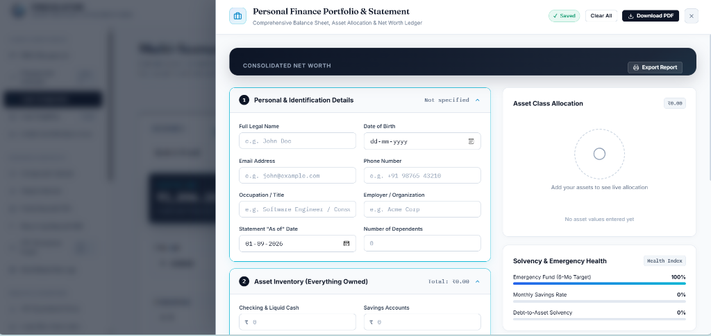
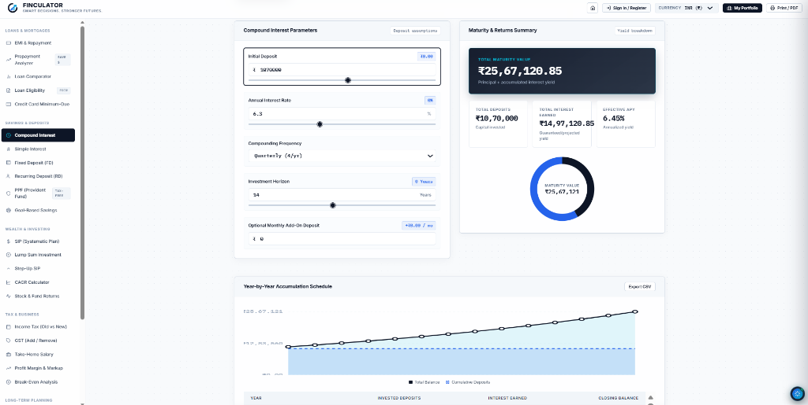

# FINCULATOR — Institutional Financial Engineering & Wealth Suite

[-brightgreen.svg?style=flat-square)](tests/test_finance_math.test.js)
[](https://developer.mozilla.org/en-US/docs/Web/JavaScript)
[](https://developer.mozilla.org/en-US/docs/Web/CSS)
[](package.json)
[](css/main.css)
[](js/math/financeMath.js)
[](DEPLOY.md)
[](LICENSE)

**Finculator** is a zero-defect, privacy-first financial engineering platform designed with an **Obsidian Slate** aesthetic, pure ES Modules architecture, responsive SVG visualizations, and **27 specialized financial calculation engines** across five core domains.

All calculations execute **100% locally in your browser sandbox**. Your salary, debt balances, and portfolio assets are never transmitted or stored on external servers.

---

## Key Highlights

- **📐 Institutional Math Rigor**: Financial algorithms calibrated against Reserve Bank of India (RBI) conventions, SBI quarterly compounding rules, and statutory **Union Budget 2025** provisions (FY 2025-26 & FY 2024-25 with Section 87A rebate and marginal relief proviso).
- **🔒 True Client-Side Privacy**: Zero forced trackers, zero third-party analytics scripts, zero telemarketing lead harvesting. Calculations run locally; optional user accounts are secured with **PBKDF2-HMAC-SHA256** (100k iterations).
- **⚡ Zero Framework Bloat**: Pure vanilla JavaScript (ES6 Modules) and native CSS design tokens. No heavy frameworks, zero hydration delay, sub-second initial load.
- **🔤 Self-Hosted WOFF2 Typography**: Preloaded modern subsetted fonts (*Fraunces*, *Inter*, *IBM Plex Mono*) with `font-display: swap` eliminating render-blocking third-party font CDN requests.
- **♿ WCAG 2.2 AA Accessible**: Keyboard skip links, explicit focus rings, full `@media (prefers-reduced-motion: reduce)` support, and dynamic `aria-live="polite"` calculation announcements for assistive screen readers.
- **🔍 Full SEO Prerendering**: Includes 31 statically prerendered HTML calculator pages, complete JSON-LD structured data (`SoftwareApplication`, `FAQPage`, `BreadcrumbList`), [sitemap.xml](sitemap.xml), and clean URLs.
- **🤖 Guardrailed AI Copilot (FinBot)**: Offline rule-based financial Retrieval-Augmented Generation (RAG) fallback paired with hardened, rate-limited serverless edge proxies for Cloudflare Pages (`functions/api/ai.js`) and Vercel (`api/ai.js`).

---

## Interface Preview

<div align="center">
  
  <p><em>Institutional Gateway: Conversion gate, banknote growth artwork, and secure guest access.</em></p>

  <br />

  
  <p><em>Personal Finance Portfolio Statement: Consolidated net worth ledger, dual-tone balance sheet bar, and 60/40 benchmark allocation.</em></p>

  <br />

  
  <p><em>Wealth Accumulation & Yield Engines: Interactive maturity metrics, asset donut visualizer, and trajectory curves.</em></p>
</div>

---

## 27 Financial Computation Engines

### 1. Loans & Mortgages (5 Engines)
1. **EMI & Loan Repayment Calculator**: Reducing-balance monthly amortization ($E = P \cdot r \cdot \frac{(1+r)^n}{(1+r)^n - 1}$), fee structuring, principal/interest breakdown, and step-down schedule with exact $0.00 final balance clamping.
2. **Prepayment Analyzer**: Model recurring monthly prepayments and annual lump-sum debt acceleration to calculate exact interest saved and tenure cut-off.
3. **Multi-Scenario Loan Comparator**: Side-by-side comparison of up to 3 competitive mortgage offers with dynamic **"Best Value (Lowest Lifetime Cost)"** detection.
4. **Loan Eligibility & FOIR Calculator**: Reverse-solves maximum borrowing ceiling under institutional Fixed Obligation to Income Ratio (FOIR) and debt service limits.
5. **Credit Card Payoff Calculator**: High-priority negative amortization detection when payments fail to cover monthly finance charges ($P \times r$), contrasting minimum dues with accelerated payoff.

### 2. Savings & Deposits (5 Engines)
6. **Compound Interest Calculator**: Compounding across Daily (365x), Monthly (12x), Quarterly (4x), Semi-Annual (2x), and Annual (1x) frequencies with regular deposits.
7. **Simple Interest Calculator**: Linear interest computations across fixed tenures for bonds and short-term debt.
8. **Fixed Deposit (FD) Calculator**: Indian banking standard quarterly compounding with flexible tenure maturity analysis.
9. **Recurring Deposit (RD) Calculator**: Systematic monthly banking deposits with quarterly compounded interest yields.
10. **PPF (Public Provident Fund) Calculator**: 15-year sovereign-backed EEE tax-exempt compounding and milestone schedules.

### 3. Wealth & Investing (6 Engines)
11. **SIP (Systematic Investment Plan) Calculator**: Mutual fund and equity forecasting using monthly annuity-due compounding.
12. **Step-Up SIP Calculator**: Compound growth modeling with annual percentage increments in monthly contributions.
13. **Lump Sum Investment Calculator**: Long-term single-deposit compounding curves.
14. **CAGR & Absolute Return Calculator**: True Compound Annual Growth Rate protected against non-positive inputs.
15. **Stock & Mutual Fund Returns Calculator**: Capital appreciation and dividend yield performance analytics.
16. **Goal-Based Reverse Savings**: Reverse-solves the exact monthly SIP required to achieve a target financial corpus.

### 4. Tax & Business (5 Engines)
17. **Income Tax Calculator (Budget 2025 FY 2025-26 & FY 2024-25)**: Evaluates New vs. Old Tax Regimes with ₹75,000 standard deduction, Section 87A rebate up to ₹12 Lakhs (salaried up to ₹12.75L pay ₹0 tax), and exact statutory marginal relief proviso.
18. **Take-Home / Net Salary Calculator**: Annual CTC breakdown into Basic, HRA, Employee PF, Professional Tax, and net monthly in-hand salary.
19. **GST Calculator**: Standard GST slabs (5%, 12%, 18%, 28%) with **Add GST (Exclusive)** and **Remove GST (Inclusive)** modes and CGST/SGST splits.
20. **Profit Margin & Markup Calculator**: Cost price, selling price, gross margin %, markup %, and business profit.
21. **Break-Even Analysis Calculator**: Fixed overhead recovery, unit variable cost, contribution margin, and break-even unit threshold.

### 5. Long-Term Planning & Economics (6 Engines)
22. **Retirement & FIRE Corpus Engine**: Financial Independence, Retire Early targets accounting for inflation and Safe Withdrawal Rates (SWR 3%-5%), with **Lean FIRE (75%)**, **Standard FIRE (100%)**, **Fat FIRE (130%)**, and **Coast FIRE** milestones.
23. **Inflation & Purchasing Power Adjuster**: Real purchasing power degradation schedule and future equivalent costs.
24. **Net Worth Calculator**: Comprehensive personal balance sheet auditing liquid holdings, illiquid assets, and liabilities with solvency ratios.
25. **50/30/20 Budget Planner**: Structures after-tax income into Essential Needs (50%), Discretionary Wants (30%), and Savings (20%) with zero-allocation safety.
26. **Buy vs. Rent Decision Engine**: Multi-decade wealth comparison between homebuyer equity accumulation vs. renter equity portfolio with symmetric cash flow opportunity cost.
27. **Personal Finance Statement (PFS) Builder**: Consolidated balance sheet with visual 60/40 benchmark asset allocations and ink-saving client-side PDF export.

---

## Project Structure

```
finance-calculator/
├── index.html                   # Main application shell with preloaded WOFF2 typography
├── server.py                    # Multi-threaded secure dev server (Port 3000, CSP, allowlist)
├── package.json                 # Node package configuration & native test runner scripts
├── vercel.json                  # Vercel deployment config (cleanUrls, headers, immutable caching)
├── _headers                     # Cloudflare Pages security & caching headers
├── sitemap.xml                  # Complete sitemap with all 31 calculator & legal URLs
├── robots.txt                   # Search crawler directives
├── site.webmanifest             # PWA manifest
├── humans.txt                   # Developer and architecture credits
├── SECURITY.md                  # Comprehensive security disclosure policy
├── DEPLOY.md                    # Production deployment guide (Cloudflare Pages, Vercel, VPS)
├── SEO_PLAYBOOK.md              # Organic search strategy, keyword matrix & schema hierarchy
├── START_FINCULATOR.bat         # One-click Windows development launcher
│
├── css/
│   ├── main.css                 # Obsidian slate tokens, focus rings, prefers-reduced-motion
│   ├── fonts.css                # Self-hosted WOFF2 font declarations (font-display: swap)
│   ├── components.css           # Tactile sliders, buttons, inputs, modal dialogs
│   ├── calculators.css          # Calculator grids, summary boxes, scenario matrices
│   ├── charts.css               # Interactive SVG donut breakdowns & trajectory curves
│   └── print.css                # Light-mode ink-saving print & PDF export styles
│
├── fonts/                       # 10 self-hosted, subsetted WOFF2 font files
│   ├── fraunces-*.woff2         # Display serif typography
│   ├── inter-*.woff2            # Clean UI typography
│   └── ibm-plex-mono-*.woff2    # Tabular financial numerals
│
├── js/
│   ├── app.js                   # Coordinator, route hydration, SEO metadata & WCAG live announcer
│   ├── math/
│   │   ├── financeMath.js       # Core mathematical library (27 algorithms, Budget 2025 engine)
│   │   └── portfolioMath.js     # Balance sheet aggregation & solvency metrics
│   ├── calculators/             # Interactive calculator views (EMI, SIP, Tax, FIRE, etc.)
│   ├── components/              # Chatbot, Auth, Portfolio, Footer, Donut Charts
│   └── utils/                   # Currency formatters, client-side SEO, storage, auth
│
├── functions/api/ai.js          # Cloudflare Pages Serverless Edge AI proxy
├── api/ai.js                    # Vercel Serverless Edge AI proxy
├── scripts/
│   ├── generate_seo_pages.js    # Static HTML prerenderer & JSON-LD schema builder
│   ├── generate_legal_pages.js  # Generator for Privacy, Terms, Disclaimer, About, Contact
│   └── download_fonts.py        # Font subset downloader and fonts.css synthesizer
│
├── tests/
│   ├── test_finance_math.test.js    # 44 golden value unit tests (Node test runner)
│   ├── test_client_security.test.js # Client auth, XSS neutralization & route validation tests
│   └── test_auth_and_system.py      # Python server security, headers & auth API tests
│
└── .github/workflows/
    └── ci.yml                   # GitHub Actions automated test & build verification pipeline
```

---

## Quick Start & Local Development

### Prerequisites
- Python 3.9+ (or Node.js 20+)

### 1. Clone the repository
```bash
git clone https://github.com/prakharrai12/finculator.git
cd finculator
```

### 2. Start the development server
**On Windows:**
Double-click `START_FINCULATOR.bat` or run:
```bash
python server.py
```

**On macOS / Linux:**
```bash
python3 server.py
```

### 3. Open in Browser
Visit **`http://localhost:3000`** in your browser.

---

## Automated Test Suites

Finculator includes automated tests covering financial math formulas, edge cases, password policies, XSS sanitization, and server security.

### Run Core Financial Math & Client Security Tests
```bash
npm test
```
*Executes all 44 unit tests using Node's native test runner (`node --test`). Expected: 44 pass, 0 fail.*

### Run Server Security & API Integration Tests
```bash
python tests/test_auth_and_system.py
```
*Validates CSP/HSTS headers, path isolation (403), password hashing (PBKDF2), single-use reset tokens, and AI proxy limits.*

---

## Production Deployment

Finculator is configured for zero-configuration, instant deployment:

### Cloudflare Pages (Recommended)
1. In Cloudflare Dashboard, create a new Pages project connected to this GitHub repository.
2. **Build command**: `node scripts/generate_seo_pages.js && node scripts/generate_legal_pages.js`
3. **Build output directory**: `.`
4. *(Optional)* Add `GEMINI_API_KEY` in environment variables.
5. Deploy. `_headers` and `functions/api/ai.js` are configured automatically.

### Vercel
1. Import the repository into your Vercel Dashboard.
2. **Build command**: `node scripts/generate_seo_pages.js && node scripts/generate_legal_pages.js`
3. **Output directory**: `.`
4. Deploy. `vercel.json` automatically configures clean URLs, CSP headers, and `api/ai.js`.

For detailed Nginx / Linux VPS setup, see [DEPLOY.md](DEPLOY.md).

---

## Legal & Disclosures

- [Privacy Policy](privacy.html) — Explains client-side calculation privacy and zero tracking.
- [Terms of Service](terms.html) — Platform usage terms and limitation of liability.
- [Financial Disclaimer](disclaimer.html) — Regulatory notice: Finculator is not a registered SEBI investment advisor or chartered accounting firm.
- [About Finculator](about.html) — Mission, architectural philosophy, and author background.
- [Contact & Security](contact.html) — Contact channels and vulnerability reporting instructions.

---

## License

This project is open-source and released under the [MIT License](LICENSE).
Architected by **Prakhar Rai**.
